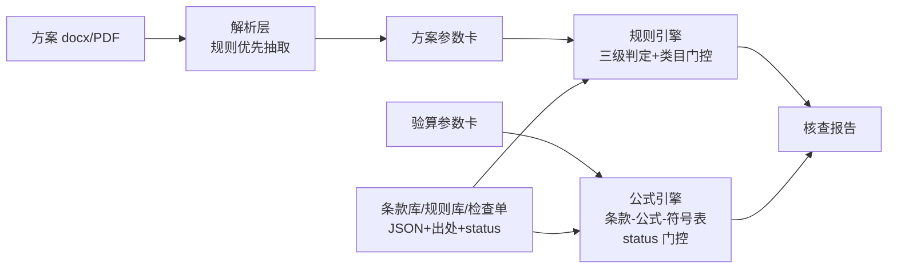

# structural-strengthening-checker

**结构加固验算与加固方案核查工具**（土木工程·既有建筑加固领域）：构件加固验算计算器（公式逐条挂规范条款）+ 加固方案文本规则核查 + GB 55021-2021 全文强制条款检查单 + 报告导出。全离线运行、内置可复现基准、确定性可评测——**非识图/CV 路线**。

> ✅ 状态：**v0.1.0 已发布**（M0 骨架 / M1 条文数据 / M2 公式引擎 / M3 方案核查 / M4 内置基准 / M5 桌面打包 / M6 脱敏发布，全部落地）。技术报告见 [docs/技术报告.md](docs/技术报告.md)。
> 定位红线：本工具是**辅助验算与核查工具，不替代正式设计文件、施工图审查与竣工验收**。

## 为什么做

GB 55021-2021《既有建筑鉴定与加固通用规范》（全文强制，2022-04-01 实施）实施后，"先鉴定、后加固"与加固设计底线要求成为刚性合规项；而常用加固构件验算依赖商业软件闭源模块（不开放计算过程），方案审查靠人工比对规范、关键参数漏查错查频发，通用规范符合性检查更无系统化工具。本项目提供**透明、可溯源、可复现**的开源实现：每个结论逐条挂依据条款号+公式编号，指标用规范算例真值公开评测。

## 功能总览（M0-M6 已全部落地）

| 模块 | 内容 | 状态 |
|---|---|---|
| 构件加固验算 | 碳纤维布加固梁受弯 / 粘钢加固受弯 / 增大截面受弯（GB 50367-2013）、植筋锚固深度（GB 50367-2013/JGJ 145-2013）；公式逐条挂已核对条款，三态判定 | ✅ M2 |
| 方案文本核查 | docx/PDF → 参数卡（正则+槽位，逐项带原文证据）→ 规则引擎三级判定（不符合/疑似/待人工确认/通过），结论挂条款出处+原文摘录 | ✅ M3 |
| GB 55021 检查单 | 全文强制条款要点化，`--doc` 自动建议 / `--interactive` 逐项核对 / `--fill` 留痕清单 | ✅ M3 |
| 报告导出 | 验算书/核查报告 docx（免责声明+签署栏+0 外链） | ✅ M4 |
| 内置基准 | 验算真值（容差判定）+ 合成方案对账（检出率/误报 0/判定准确率，一条命令 `ssc bench`，常驻 CI） | ✅ M4 |
| 桌面应用 | PySide6 四页签 + PyInstaller 打包 Windows exe（onedir 双 exe：SSC.exe GUI + ssc-cli.exe 控制台验证） | ✅ M5 |

**内置基准指标**（一条命令复现：`py -X utf8 -m structural_strengthening_checker bench`；门槛为既定口径——不达标回修实现，不放宽门槛）：

| 基准 | 指标 | 数值 | 门槛 |
|---|---|---|---|
| 验算算例（14 例，±0.5% 容差 + verdict 严格相等） | 通过率 | 100%（14/14） | 100% |
| 方案核查（合成语料 6 份：基线 + 5 注入，seed=20261005 固定现场生成） | 检出率（规则实例） | 100%（7/7） | 100% |
| 方案核查 | 误报数（期望集合之外的任何非 pass 结论） | 0 | 0 |
| 方案核查 | 判定准确率（主期望 verdict 严格相等） | 100%（7/7） | 100% |

## 快速开始

环境：Windows（第一目标）/ Linux，Python ≥3.8。

```bash
git clone https://github.com/yuluo554/structural-strengthening-checker.git
cd structural-strengthening-checker

py -m pip install -U pip          # 老 pip 无法可编辑安装 pyproject-only 项目，先升级
py -m pip install -e .[dev]

py -X utf8 -m pytest              # 测试全绿
py -X utf8 -m structural_strengthening_checker selfcheck   # 数据与模块自检
```

Linux/macOS 把 `py` 换成 `python3`。

### CLI

| 命令 | 说明 | 状态 |
|---|---|---|
| `ssc selfcheck` | 条款库/规则库/检查单/算例库 schema 守门 + 模块注册表 + extras 探测 | ✅ |
| `ssc modules` | 验算模块清单与条文核对进度 | ✅ |
| `ssc calc <module> --input x.json` | 执行验算（条款门控 + 完整计算体，三态判定） | ✅ |
| `ssc check 方案.docx` | 方案文本核查（需 `.[parse]`；`--json` / `--report DIR` 输出 JSON+docx 报告） | ✅ |
| `ssc checklist` | GB 55021 检查单（`--doc` / `--interactive` / `--fill`） | ✅ |
| `ssc bench` | 内置基准（验算真值比对 + 方案核查对账，门槛不达 exit 1） | ✅ M4 |
| `ssc report calc <module> --input x.json --out o.docx` | 验算书 docx 导出（FR-D1，需 `.[report]`） | ✅ M4 |
| `ssc report check 方案.docx --out o.docx` | 核查报告 docx 导出（FR-D2，需 `.[report]`） | ✅ M4 |
| `ssc gui` | 桌面界面四页签（需 `.[gui]`） | ✅ M5 |

### 桌面应用（M5）

```bash
py -m pip install -e .[gui,report,parse]
py -X utf8 -m structural_strengthening_checker gui
```

四页签（与 CLI 共用同一引擎与流水线，不另起第二套行为）：

- **验算表单**：选择验算模块 → 按 param_schema 动态生成参数表单（挂含义/单位/合法范围提示）→ 三态结论+逐步计算过程+依据条款；参数卡 JSON 与 `ssc calc --input` 同格式互载；可导出验算书 docx；
- **方案核查**：选择 docx/PDF 方案 → 三级判定明细树（判定/规则/结论/依据）+ 证据链详情（原文摘录/段落/数值/假设）；解析失败按降级纪律整体待人工确认；报告导出与 `ssc check --report` 同形状（JSON+docx）；
- **检查单**：GB 55021-2021 逐项判定（符合/不符合/不适用/待确认）+ 备注；载入方案可对 auto_text 条目给自动建议（宁缺勿错，绝不自动给"不符合"）；结果 JSON 与 `ssc checklist --fill` 互通；
- **报告**：验算书（FR-D1）/核查报告（FR-D2）docx 导出，与 `ssc report calc/check` 共用同一入库函数（免责声明+签署栏+0 外链）。

exe 打包（PyInstaller onedir，含内嵌知识库数据、不含任何规范全文）：

```bash
py -m pip install -e .[package,gui,report,parse]
py -X utf8 tools/build_exe.py        # 构建 + 版权/完整性红线断言（_private 永不入包）
```

**条文纪律（工程可信度的根基）**：所有公式、限值、指标以规范原文核对后入库（挂编号+条号+渠道+核对日期）；`status=待核对` 的条款被引擎硬性拦在计算路径与自动判定之外。当前条款库 52 条中 51 条已核对（逐条挂出处，见 `data/README.md` 台账），1 条（JGJ 145-2013 §6.3）因渠道不可达保持待核对留痕——宁可熔断，不虚构出处。

## 架构一览



详细设计见 [`plan/`](plan/)：[02-需求解读](plan/02-需求解读.md) · [03-架构与技术选型](plan/03-架构与技术选型.md) · [04-模块详设](plan/04-模块详设.md) · [05-数据计划与里程碑](plan/05-数据计划与里程碑.md) · [06-决策记录](plan/06-决策记录.md)。

## 目录结构

```
plan/        计划文档（00-06 + 交接快照）
data/        数据台账 + knowledge（条款库/规则库/检查单）+ cases（算例库）+ synthetic
src/structural_strengthening_checker/
             core/（零依赖核心：条款库/公式引擎/校验）
             calc/（4 个验算模块）  parsing/  checking/  report/  bench/  datagen/  gui/
tests/       pytest（schema 守门 / 门控 / 降级路径 / 项目守门）
```

## 限制与免责声明

- 本工具为**辅助验算与核查工具**，输出不构成设计文件，不替代正式设计、施工图审查与竣工验收；工程使用请以注册工程师签章文件为准。
- 不做任何图像/点云/视频输入（识图路线明确排除）；限构件级验算，不做整体结构有限元分析。
- 规范条文数值以官方出版文本为准；本仓库按版权纪律**只入库要点+短摘录+出处**，不入全文。
- 首期范围：4 个混凝土构件加固验算模块；砌体/钢结构加固为后续扩展项。

## License

[MIT](LICENSE)
